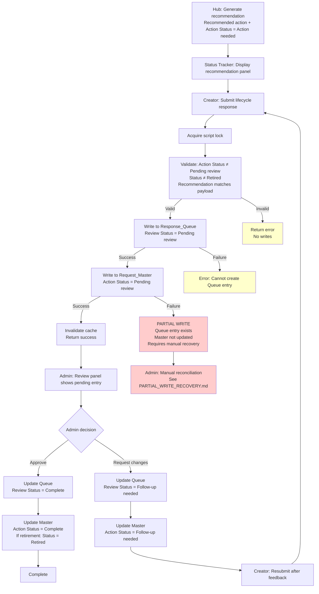

# Status Tracker Lifecycle Workflow

Internal technical reference for the Status Tracker lifecycle response system in the Interactive Experience Intake application.

---

## System at a Glance

The Status Tracker provides creators with visibility into published Interactive Demos and Video Demos, including performance metrics and lifecycle recommendations. It supports a direct creator response workflow for performance-based recommendations generated by the Hub.

**Key components**:
- **Data source**: `Request_Master` (Interactive Demos), `YouTube_Responses` (Video Demos)
- **Performance analysis**: Hub [`RM_Performance.js`](https://github.com/rubyyyyyang/interactive-experience-hub/blob/main/RM_Performance.js) generates recommendations
- **Creator interface**: Status Tracker displays recommendations and accepts lifecycle responses
- **Response workflow**: Creator submits → Queue entry created → Master status updated → Admin reviews → Approval or follow-up
- **Admin control**: `STATUS_TRACKER_ADMINS` Script Property (default: `yunjyang@redhat.com`)

**Critical architectural note**: Queue and Master writes are **sequential, non-transactional** Sheets operations. Partial-write failures are possible and require manual recovery.

---

## Workflow Overview



**Non-atomic writes**: Queue and Master updates are separate Sheets `setValue()` calls. If the Master write fails after Queue succeeds, a partial-write state occurs. See [Partial-Write Recovery](#partial-write-recovery).

---

## Purpose and Scope

The Status Tracker provides creators with visibility into the performance and lifecycle status of their published Interactive Demos and Video Demos. It supports a direct creator response workflow for performance-based lifecycle recommendations generated by the Hub's analysis system.

**Relationship to Hub**: The Status Tracker reads performance analysis data from `Request_Master` (maintained by the Hub) and provides a creator interface for responding to lifecycle recommendations. Performance scoring, tier assignment, and recommendation generation are Hub responsibilities (see Hub [`docs/architecture.md`](https://github.com/rubyyyyang/interactive-experience-hub/blob/main/docs/architecture.md) and [`RM_Performance.js`](https://github.com/rubyyyyyang/interactive-experience-hub/blob/main/RM_Performance.js)).

---

## Key Distinctions

### Status vs. Recommended action vs. Action Status

- **Status** (content lifecycle): `Published`, `Retired`, etc. Managed by Hub workflows.
- **Recommended action** (performance recommendation): `Improve completion`, `Consider retirement`, `Boost sales impact`, etc. Generated by Hub performance analysis in `RM_Performance.js`.
- **Action Status** (response workflow state): `Action needed`, `Pending review`, `Complete`, `Follow-up needed`. Tracks creator response lifecycle.

### Content Types

- **Interactive Demo**: Supports Primary Topic and Topic metadata. Performance metrics from Arcade (completion rate, players per month). Full lifecycle response support via `Request_Master`.
- **Video Demo**: No Topic metadata. Limited performance metrics. **Current limitation**: `submitCreatorResponse` only validates against `Request_Master`. Video Demo records from `YouTube_Responses` are displayed in Status Tracker but may not support direct lifecycle responses through the current endpoint.

---

## User Roles and Permissions

### Regular Users (Authenticated Red Hat Employees)

**My Submissions**:
- Displays submissions where the user's email matches Creator Email or Requestor Email in `Request_Master` or `YouTube_Responses`
- Server-side ownership calculation (`buildSubmissionFromRow_`) prevents email exposure to frontend

**All Submissions**:
- Available to all authenticated users (open collaboration model)
- Displays all Interactive Demo and Video Demo submissions
- Does not expose creator email addresses to frontend

**Lifecycle Responses**:
- Any authenticated user can submit lifecycle responses for any demo (open collaboration model)
- Authorization is at the admin approval layer, not the submission layer
- **Pending review lock**: If Action Status is `Pending review`, creators (non-admins) cannot submit another response via `submitCreatorResponse`. They must wait for admin feedback. Admins also cannot bypass this lock through `submitCreatorResponse` — they use separate admin review endpoints (`approveResponse`, `requestChanges`).

### Admins (Controlled via `STATUS_TRACKER_ADMINS`)

**Script Property**: `STATUS_TRACKER_ADMINS` — comma-separated email list
**Default**: `yunjyang@redhat.com`
**Function**: `isAdmin_(email)` in [`IA_Config.js:142-150`](IA_Config.js)

**Admin-only capabilities**:
- Access to Admin Review panel for pending lifecycle responses
- Approve or request changes to submitted lifecycle responses via `approveResponse()` and `requestChanges()` endpoints
- View all submissions with admin context (backend Status values, pending response indicators)

**Configuration**: Admins are managed via Script Properties, not code constants. Update `STATUS_TRACKER_ADMINS` in Script Properties to change admin list.

---

## UI Views and Features

### My Submissions

- Displays submissions owned by the current user (creator or requestor email match)
- Default sort: most recent submission first (`dateSubmitted` descending)
- Filters: Status dropdown, search by title or creator name
- Collapsed submission details (expand to see full metadata and response panels)

### All Submissions

- Available to all authenticated users
- Shows all submissions from `Request_Master` and `YouTube_Responses`
- Includes submissions currently being processed (`Creator_Form_Raw`, displayed as "Processing" status)
- **Admin-only**: pending response indicators (`pendingResponse` object) attached to submission rows in `getAllSubmissions()` response

### Reports

- Analytics dashboard with KPI cards, charts, and submission trends
- Read-only performance reporting
- No lifecycle action controls

### Recommendation Panels

Displayed in expanded submission detail row for published demos with creator-actionable recommendations.

**Display logic** ([`StatusTracker.html:2171-2250`](StatusTracker.html)):

**Update needed** (`Improve completion`):
- **Trigger**: `Recommended action = 'Improve completion'` AND `Action Status ≠ 'Complete'` AND `Status ≠ 'Retired'`
- **Evidence**: Completion rate percentage, avg. monthly players
- **Baselines**: 40% completion rate, 15 players/month (matches Hub `PERF_THRESHOLDS` in `RM_Performance.js`)
- **Response options**: `Updated`, `Need help`
- **Optional fields**: New Creation Link, Additional notes

**Retirement review** (`Consider retirement`):
- **Trigger**: `Recommended action = 'Consider retirement'` AND `Action Status ≠ 'Complete'` AND `Status ≠ 'Retired'`
- **Evidence**: Players per month, content age, MTPV pipeline/won
- **Scenarios**: Low usage (below baseline) or no activity (content age with zero recorded plays)
- **Response options**: `Keep active`, `Retire`, `Need help`
- **Optional fields**: Additional notes

**Top performer**:
- **Trigger**: `Performance Tier = 'Top'` AND no creator-required action (`Recommended action ≠ 'Improve completion'` AND `≠ 'Consider retirement'`)
- Read-only badge (informational only, no response panel)

**Hidden when**:
- `Action Status = 'Complete'` (response approved and applied)
- `Status = 'Retired'` (demo retired, no further responses accepted)

### Lifecycle Timeline

- Horizontal visual timeline showing content lifecycle stages
- **Standard stages**: Request Open → Request Approved → Demo Received → Demo Reviewed → Published → Retired → Closed
- **Creator-only submissions**: Skips Request Open and Request Approved (no formal request workflow)
- **Video Demos**: Published → Retired only (simplified lifecycle)
- Current stage highlighted, completed stages checkmarked, future stages grayed out
- Timestamps displayed below each stage icon (from `statusTimestamps` object)

### Performance Snapshot

Displayed for Published demos with available performance data.

**Five-card compact layout** ([`StatusTracker.html:1659-1755`](StatusTracker.html)):
1. Avg. monthly players (benchmark: 15/month)
2. Completion rate (benchmark: 40%)
3. Attributed pipeline (MTPV, all-time)
4. Attributed won (MTPV, all-time)
5. Content age (months since published)

**Data source**: `Request_Master` performance columns populated by Hub `RM_Performance.js`

**Last refreshed**: `Metrics Last Sync` timestamp

**Display rule**: Only shown when at least one performance metric is available (`playersPerMonth`, `completionRate`, `mtOpportunity`, `mtWon`, or `contentAge` is not empty)

### Collapsed Submission Details

Metadata, links, description, and reference information are collapsed by default and expand on click. This reduces visual noise while allowing users to access full context when needed.

**Collapsible sections** ([`StatusTracker.html:1819-1984`](StatusTracker.html)):
- Demo links (Creation, Production, Drupal Page)
- Core metadata (Final Demo Title, Primary Product, Primary Topic, TDP, Content Type, Creator, Creator Team)
- More metadata disclosure (Product, Topic, Duration, Language, Quarter, Verticals, Event, Sales Tactic, Marketing Program, etc.)
- Description (truncated to 200 characters, expandable with "Show more" toggle)
- CTA links (parsed from `CTALink` field, displayed as clickable list)
- Reference row (Origin Type, Global ID, Creation Brief link)

**Implementation**: JavaScript toggle functions (`toggleSubmissionDetails`, `toggleMoreMetadata`, `toggleDesc`)

---

## Creator Response Actions

### Supported Actions

Only lifecycle responses are supported. Metadata editing is not available in Status Tracker ([`IA_StatusTracker.js:644-654`](IA_StatusTracker.js)).

**Improve completion** (`Recommended action = 'Improve completion'`):
- **Response values**: `Updated`, `Need help`
- **Optional**: New Creation Link (updated Arcade or YouTube URL)
- **Optional**: Additional notes

**Consider retirement** (`Recommended action = 'Consider retirement'`):
- **Response values**: `Keep active`, `Retire`, `Need help`
- **Optional**: Additional notes

### Validation Rules

**Pre-submission validation** (client-side, [`StatusTracker.html`](StatusTracker.html)):
- Response value must be selected from valid options for the action
- Recommended action in payload must match current `Recommended action` in Master (prevents stale submissions)

**Server-side validation** ([`IA_StatusTracker.js:592-774`](IA_StatusTracker.js)):
1. User must be authenticated (`Session.getActiveUser().getEmail()`)
2. Demo must exist in `Request_Master` (lookup by `Number` column)
3. Submission type must be `lifecycle_response`
4. Recommended action must be supported (`Improve completion` or `Consider retirement`)
5. Recommended action in payload must match current Master value (fail-closed, [`IA_StatusTracker.js:752-773`](IA_StatusTracker.js))
6. Response value must be valid for the action
7. **Post-lock validation** (bypasses cache): Re-read Master row to verify Action Status, Status, and Recommended action

**Blocking conditions**:
- **Retired demos**: Lifecycle responses not allowed (`Status = 'Retired'`, [`IA_StatusTracker.js:634-636`](IA_StatusTracker.js))
- **Pending review lock**: If `Action Status = 'Pending review'`, only admins can submit via admin endpoints. Both creators and admins are blocked from using `submitCreatorResponse` ([`IA_StatusTracker.js:638-642, 738-740`](IA_StatusTracker.js)). Admin review uses separate endpoints: `approveResponse()`, `requestChanges()`.
- **Complete actions**: No further responses accepted (`Action Status = 'Complete'`, [`IA_StatusTracker.js:742-744`](IA_StatusTracker.js))

### Submission Flow

1. Creator expands submission row and sees recommendation panel
2. Creator selects response value from valid options
3. (Optional) Creator provides new link or notes
4. Creator clicks Submit
5. **Lock acquisition**: 10-second timeout on script lock ([`IA_StatusTracker.js:675-676`](IA_StatusTracker.js))
6. **Post-lock validation**: Direct sheet read bypasses cache to verify Action Status, Status, and Recommended action ([`IA_StatusTracker.js:679-774`](IA_StatusTracker.js))
7. **Queue append**: New row appended to `Response_Queue` with `Review Status = 'Pending review'` ([`IA_StatusTracker.js:776-817`](IA_StatusTracker.js))
8. **Master update** (non-atomic, separate operation): `Action Status` set to `Pending review` in `Request_Master` ([`IA_StatusTracker.js:820-829`](IA_StatusTracker.js))
9. **Cache invalidation**: Status Tracker cache cleared ([`IA_StatusTracker.js:831`](IA_StatusTracker.js))
10. **Success response**: Returns minimal status update for client-side state merge

**Error handling**:
- **Partial-write scenario**: If Master update fails after Queue append, a partial-write state occurs. User sees error message: "Your response was recorded in Response_Queue but Request_Master could not be updated. Contact an administrator to reconcile. Do NOT retry." See [Partial-Write Recovery](#partial-write-recovery).
- **Preflight validation failure**: No writes, error returned to user
- **Queue append failure**: Error returned, no Master update attempted

---

## State Transitions

| Current Action Status | Actor | Trigger | Next Action Status | Master Fields Updated | Queue Fields Updated |
|----------------------|-------|---------|-------------------|----------------------|---------------------|
| `Action needed` | Creator | Submit lifecycle response | `Pending review` | Action Status | Review Status, Action Taken, New Creation Link, Additional Comments, Timestamp, Recommended Action, Assigned, Creator Name, Creator Email, Demo Title |
| `Follow-up needed` | Creator | Resubmit after feedback | `Pending review` | Action Status | Review Status, Action Taken, New Creation Link, Additional Comments, Timestamp (new Queue row appended) |
| `Pending review` | Admin | Approve response | `Complete` | Action Status, Action Completed Date, Creation Link (if new link provided), **Status and Status Retired Timestamp if retirement** | Review Status, Admin Notes, Action Completed Date |
| `Pending review` | Admin | Request changes | `Follow-up needed` | Action Status | Review Status, Admin Notes |
| `Complete` | — | — | (terminal) | — | — |

**Important notes**:
- Each creator resubmission creates a **new Queue row** (history-preserving model, [`IA_StatusTracker.js:777-817`](IA_StatusTracker.js))
- Latest pending entry for a demo is identified by `Demo Number` + `Review Status = 'Pending review'`
- **Retirement special case**: When approving a retirement response (`Action Taken = 'Retire'`), admin approval also updates `Status → 'Retired'` and `Status Retired Timestamp → current timestamp` in Master ([`IA_StatusTracker.js:1091-1122`](IA_StatusTracker.js))

---

## Response Queue and Master Updates

### Response_Queue Schema

**Primary fields** ([`IA_Config.js:683-691`](IA_Config.js)):
- **Demo Number**, **Number**: Demo identifier (both populated for compatibility)
- **Review Status**: `Pending review`, `Complete`, `Follow-up needed` (column may be named "Action Status" in physical sheet, code handles both)
- **Timestamp**: Response submission timestamp
- **Action Taken**: Creator's selected response (`Updated`, `Keep active`, `Retire`, etc.)
- **New Creation Link**: Optional updated demo URL
- **Additional Comments**: Optional creator notes
- **Admin Notes**: Admin feedback (visible to creator for `Follow-up needed` entries)
- **Action Completed Date**: Set when admin approves
- **Recommended Action**: Snapshot of recommendation at submission time
- **Assigned**, **Creator Name**, **Creator Email**: Copied from Master at submission time

**History model**: Queue preserves all responses. Latest pending entry for a demo is identified by `Demo Number` + `Review Status = 'Pending review'` ([`IA_StatusTracker.js:851-898, 901-959`](IA_StatusTracker.js)).

**Sheet creation**: Created on-demand by `getResponseQueueSheet_()` if not present ([`IA_StatusTracker.js:535-544`](IA_StatusTracker.js))

**Migration compatibility**: Physical sheet column "Action Status" should be renamed to "Review Status". Code handles both names ([`IA_StatusTracker.js:794, 869, 921, 1027, 1189`](IA_StatusTracker.js)).

### Request_Master Updates

**On creator submission** ([`IA_StatusTracker.js:820-829`](IA_StatusTracker.js)):
- **Action Status** → `Pending review`
- **Non-atomic write**: Separate `setValue()` call after Queue append. Partial failure possible.

**On admin approval** ([`IA_StatusTracker.js:1096-1128`](IA_StatusTracker.js)):
- **Action Status** → `Complete`
- **Action Completed Date** → Current timestamp
- **Creation Link** → New Creation Link (if provided in response)
- **If retirement** (`Action Taken = 'Retire'`):
  - **Status** → `Retired`
  - **Status Retired Timestamp** → Current timestamp

**On admin request changes** ([`IA_StatusTracker.js:1245-1254`](IA_StatusTracker.js)):
- **Action Status** → `Follow-up needed`

### Partial-Write Recovery

**Scenario**: Queue append succeeds, Master update fails.

**User error message** ([`IA_StatusTracker.js:826-828`](IA_StatusTracker.js)):
```
Your response was recorded in Response_Queue but Request_Master could not be updated.
Contact an administrator to reconcile. Do NOT retry.
```

**Manual recovery steps** (Admin):

1. **Verify partial state**:
   - Check `Response_Queue` for entry with `Review Status = 'Pending review'`
   - Check `Request_Master` for same demo number with `Action Status ≠ 'Pending review'`
   - Confirms partial write occurred

2. **Choose reconciliation path**:
   - **Option A** (response is valid): Manually set Master `Action Status` to `Pending review`, then use Admin Review UI to approve/reject normally
   - **Option B** (response is invalid): Mark Queue entry `Review Status` as `Rejected` or delete row, inform creator to resubmit

**Prevention**: Preflight validation ([`IA_StatusTracker.js:684-774`](IA_StatusTracker.js)) checks Master row existence and state before Queue append. Post-lock validation bypasses cache to prevent stale reads. Remaining failure scenarios are Sheets API errors, permission errors, or concurrent modification conflicts (rare).

**Detailed procedures**: See [`PARTIAL_WRITE_RECOVERY.md`](../PARTIAL_WRITE_RECOVERY.md)

---

## Visibility of Pending Responses

### Submitted Response Indicator (All Authenticated Users)

**Endpoint**: `getSubmittedResponse(demoNumber)` ([`IA_StatusTracker.js:901-959`](IA_StatusTracker.js))

**Returns** (for demos with `Review Status = 'Pending review'`):
- Submitter email (`email` or `Creator Email` column in Queue)
- Timestamp
- Action Taken
- New Creation Link
- Additional Comments
- Recommended Action

**Display**: Shown in recommendation panel under "A response has been submitted" section ([`StatusTracker.html:2214-2247`](StatusTracker.html))

**Note**: Submitter name is not in Response_Queue schema. Only email is available for attribution.

### Admin Review Panel (Admins Only)

**Endpoint**: `getLatestPendingQueueEntry(demoNumber)` ([`IA_StatusTracker.js:851-898`](IA_StatusTracker.js))

**Returns**: Full Queue row for latest `Pending review` entry

**Display**: Admin-only review UI with Approve / Request Changes buttons, Admin Notes field, and full response details

**Attachment**: In `getAllSubmissions()` ([`IA_StatusTracker.js:397-418`](IA_StatusTracker.js)), admins see `pendingResponse` object attached to submission objects for display in table row or detail panel

---

## Retirement Behavior

### Recorded Retirement

When admin approves a retirement response (`Action Taken = 'Retire'`) via `approveResponse()`:

**Master updates** ([`IA_StatusTracker.js:1091-1122`](IA_StatusTracker.js)):
1. **Status** → `Retired`
2. **Status Retired Timestamp** → Current timestamp
3. **Action Status** → `Complete`
4. **Action Completed Date** → Current timestamp

**Effect on Status Tracker**:
- Submission appears in All Submissions with Status badge = `Retired`
- No further lifecycle responses accepted (validation blocks submissions, [`IA_StatusTracker.js:634-636, 746-748`](IA_StatusTracker.js))
- Recommendation panel hidden (`Status = 'Retired'` hides panel)
- Lifecycle timeline shows Retired stage as current

### Hub Lifecycle Email Integration Gap

**Expected behavior**: Hub sends retirement lifecycle email when `Status = 'Retired'` (per Hub [`docs/creator-lifecycle-emails.md`](https://github.com/rubyyyyang/interactive-experience-hub/blob/main/docs/creator-lifecycle-emails.md))

**Actual trigger mechanism**: Hub retirement emails are triggered by `onEdit` installable trigger when Status column is manually edited in Sheets UI ([Hub `RM_Triggers.js:82-103`](https://github.com/rubyyyyyang/interactive-experience-hub/blob/main/RM_Triggers.js))

**Integration gap**: Programmatic `setValue()` calls from Status Tracker `approveResponse()` **do not fire spreadsheet edit triggers**. The Hub's `onEdit` trigger will not detect the Status change to `Retired` when it is written via Apps Script.

**Implication**: Retirement lifecycle emails may not be sent when retirement is approved through Status Tracker unless the Hub has an alternative trigger mechanism (e.g., time-based workflow polling for Status changes).

**Verification needed**: Check if Hub has a polling workflow or alternative trigger for detecting programmatic Status changes. If not, retirement approvals via Status Tracker may require manual email notification or a code change to trigger Hub email dispatch.

### Unpublishing (External Drupal Process)

**Status Tracker boundary**: Status Tracker records the `Retired` status but does not trigger or manage Drupal unpublishing.

**Drupal unpublishing**: A separate manual or automated process outside the Intake/Hub Apps Script codebase. Not documented here.

**Important**: `Retired` status in Master is the source of truth for retirement. Any downstream Drupal actions are external to the Apps Script workflow.

---

## Data Sources and Key Functions

### Data Sources

**Primary**: `Request_Master` sheet in Master Spreadsheet
- Performance analysis columns populated by Hub `RM_Performance.js`
- Action Status, Action Completed Date managed by Status Tracker lifecycle workflow
- **Current support**: Full lifecycle response workflow via `submitCreatorResponse()`, `approveResponse()`, `requestChanges()`

**YouTube**: `YouTube_Responses` sheet in Master Spreadsheet
- Separate lifecycle source for Video Demos
- Same schema as Request_Master for Status Tracker display purposes
- **Current limitation**: `submitCreatorResponse()` validates only against `Request_Master` ([`IA_StatusTracker.js:603-691`](IA_StatusTracker.js)). Video Demo records are displayed in Status Tracker but direct lifecycle responses may not be fully supported.

**Pending Submissions**: `Creator_Form_Raw` sheet in Master Spreadsheet
- Displays submissions not yet written to Master as "Processing" status
- Read-only display in Status Tracker (no lifecycle actions available)
- Retrieved by `getPendingIntakeSubmissions_()` ([`IA_StatusTracker.js:432-506`](IA_StatusTracker.js))

**Response Queue**: `Response_Queue` sheet in Master Spreadsheet
- Created on-demand by `getResponseQueueSheet_()` if not present ([`IA_StatusTracker.js:535-544`](IA_StatusTracker.js))
- History-preserving log of all lifecycle responses

### Key Functions

**Data retrieval** ([`IA_StatusTracker.js`](IA_StatusTracker.js)):
- `getRequestMasterData_()`: Cached read of Request_Master (excludes Guide Extraction JSON column to stay under 100KB cache limit)
- `getYouTubeResponsesData_()`: Cached read of YouTube_Responses
- `getPendingIntakeSubmissions_()`: Read pending submissions from Creator_Form_Raw
- `getResponseQueueData_()`: Read all Response_Queue entries

**User endpoints**:
- `getMySubmissions(searchName)`: Filter by user email or admin search by creator name
- `getAllSubmissions()`: All submissions with admin-only pending response attachment
- `getSubmissionStatus(globalId)`: Single submission lookup by Global ID
- `getDemoMetadata(requestNumber)`: Metadata snapshot for a demo

**Lifecycle actions**:
- `submitCreatorResponse(payload)`: Creator lifecycle response submission with lock, validation, and sequential Queue+Master writes (non-atomic)
- `getSubmittedResponse(demoNumber)`: Retrieve pending response indicator (all users)
- `getLatestPendingQueueEntry(demoNumber)`: Admin-only pending entry retrieval
- `getLatestAdminFeedback(demoNumber)`: Retrieve admin feedback for `Follow-up needed` entries

**Admin actions**:
- `approveResponse(queueRowIndex, adminNotes)`: Approve pending response, update Queue to `Complete`, update Master to `Complete`, apply retirement if applicable
- `requestChanges(queueRowIndex, adminNotes)`: Request changes, update Queue to `Follow-up needed`, update Master to `Follow-up needed`, write admin feedback
- `rejectResponse(queueRowIndex, adminNotes)`: Alias for `requestChanges()` (backward compatibility)
- `getReviewQueue()`: Admin-only review queue with pending entries and attached submission context

### Cache Behavior

**Cache keys** ([`IA_StatusTracker.js:6-7`](IA_StatusTracker.js)):
- `st_master_data`: Request_Master data
- `st_youtube_data`: YouTube_Responses data

**TTL**: 90 seconds ([`IA_StatusTracker.js:8`](IA_StatusTracker.js))

**Invalidation**: `invalidateStatusTrackerCache_()` clears both caches and runtime memos after Master updates ([`IA_StatusTracker.js:101-106`](IA_StatusTracker.js))

**Runtime memo**: In-memory cache (`ST_RUNTIME_MEMO_`, `ST_YT_RUNTIME_MEMO_`) survives for the duration of a single script execution

**Race condition protection**: Post-lock validation re-reads Master directly from sheet to bypass both CacheService and runtime memo before writes ([`IA_StatusTracker.js:684-774`](IA_StatusTracker.js))

---

## Current Notification Boundaries

**Hub lifecycle emails** (see Hub [`docs/creator-lifecycle-emails.md`](https://github.com/rubyyyyyang/interactive-experience-hub/blob/main/docs/creator-lifecycle-emails.md)):
- Submission received (Interactive Demo, Video Demo)
- Published (Interactive Demo only, requires Status = Published + Drupal Page URL)
- Retired (Interactive Demo, Video Demo) — **See integration gap note in [Retirement Behavior](#hub-lifecycle-email-integration-gap)**

**Status Tracker**:
- No email notifications currently sent by Status Tracker
- Creators see response state (Pending review, Follow-up needed, Complete) in UI only
- Admin feedback visible in recommendation panel when `Action Status = 'Follow-up needed'`

**Future consideration**: Status Tracker could send reminder emails for `Action needed` recommendations or `Follow-up needed` feedback, but this is not currently implemented.

---

## Limitations and Implementation Gaps

### Known Limitations

1. **Metadata editing**: Not supported in Status Tracker. Creators can only submit lifecycle action responses, not edit demo metadata directly ([`IA_StatusTracker.js:644-654`](IA_StatusTracker.js)).

2. **Email notifications**: Status Tracker does not send email reminders for pending actions or admin feedback. Creators must check Status Tracker UI for updates.

3. **Multiple pending responses**: Creators cannot submit a second response while one is `Pending review`. They must wait for admin review before resubmitting. Admins also cannot bypass this lock via `submitCreatorResponse` — admin review uses separate endpoints.

4. **Link updates outside lifecycle actions**: Creators cannot update Creation Link or Production Link except as part of a lifecycle response (`Improve completion` flow with New Creation Link field).

5. **Retirement response visibility**: Once approved, retirement responses show `Action Status = 'Complete'` and hide recommendation panel. Creators cannot see approval timestamp or admin notes after approval (visible only during `Pending review` and `Follow-up needed` states).

6. **Performance data freshness**: Performance metrics displayed in Performance Snapshot are sourced from Hub's `Metrics Last Sync` timestamp. Staleness is visible to users but refresh is a Hub responsibility.

7. **Video Demo lifecycle responses**: `submitCreatorResponse()` validates only against `Request_Master`. Video Demo records from `YouTube_Responses` are displayed in Status Tracker, but direct lifecycle response submission may not be fully supported.

### Implementation Gaps

1. **Retirement email integration**: Programmatic `setValue()` in `approveResponse()` does not fire Hub's `onEdit` trigger. Retirement lifecycle emails may not be sent automatically when retirement is approved via Status Tracker. **Verification needed**: Check if Hub has polling workflow for detecting programmatic Status changes.

2. **Non-atomic writes**: Queue and Master updates are sequential, non-transactional Sheets operations. Partial-write failures require manual recovery. Apps Script does not support database-style transactions.

3. **Test coverage**: While there are 52 test files in the repository, only 2 are directly related to Status Tracker lifecycle vocabulary (`retirement-status-value.test.js`, `action-status-vocabulary.test.js`). End-to-end workflow tests for creator submission, admin approval, and partial-write recovery are not documented.

---

## Where to Make Changes

| Task | File(s) | Function(s) / Section(s) |
|------|---------|--------------------------|
| Add/modify lifecycle response validation | [`IA_StatusTracker.js`](IA_StatusTracker.js) | `submitCreatorResponse()` lines 592-849 |
| Change admin permission list | Script Properties | `STATUS_TRACKER_ADMINS` (comma-separated emails) |
| Modify recommendation panel UI | [`StatusTracker.html`](StatusTracker.html) | `buildActionBanner()` lines 2171-2250, CSS lines 932-977 |
| Update state transition logic | [`IA_StatusTracker.js`](IA_StatusTracker.js) | `approveResponse()` lines 1014-1163, `requestChanges()` lines 1165-1278 |
| Change cache TTL or invalidation | [`IA_StatusTracker.js`](IA_StatusTracker.js) | `ST_CACHE_TTL_` line 8, `invalidateStatusTrackerCache_()` lines 101-106 |
| Modify Response_Queue schema | [`IA_Config.js`](IA_Config.js) | `RESPONSE_QUEUE_HEADERS_` lines 683-691 |
| Add/remove editable metadata fields | [`IA_Config.js`](IA_Config.js) | `EDITABLE_METADATA_FIELDS_` lines 100-138 |
| Update Status Tracker column mappings | [`IA_Config.js`](IA_Config.js) | `STATUS_TRACKER_COLUMNS` lines 15-96 |
| Modify performance baselines (UI display only) | [`StatusTracker.html`](StatusTracker.html) | `CREATOR_DISPLAY_BASELINES` lines 2039-2041 |
| Change Hub performance analysis logic | Hub [`RM_Performance.js`](https://github.com/rubyyyyang/interactive-experience-hub/blob/main/RM_Performance.js) | `runPerformanceLabels()`, `PERF_THRESHOLDS` |
| Add retirement email trigger | Hub [`RM_Triggers.js`](https://github.com/rubyyyyyang/interactive-experience-hub/blob/main/RM_Triggers.js) or [`RM_Creator_Lifecycle_Notifications.js`](https://github.com/rubyyyyyang/interactive-experience-hub/blob/main/RM_Creator_Lifecycle_Notifications.js) | Alternative trigger mechanism for programmatic Status changes |
| Deploy to Apps Script | [`docs/deployment-runbook.md`](deployment-runbook.md) | Complete release process with code review, Team Testing, Production deployment |

---

## Testing and Verification

### Test Coverage

**Total test files**: 52 ([`tests/`](../tests/) directory)

**Status Tracker specific tests**: 2 verified
- [`retirement-status-value.test.js`](../tests/retirement-status-value.test.js): Tests retirement status handling
- [`action-status-vocabulary.test.js`](../tests/action-status-vocabulary.test.js): Tests Action Status normalization and vocabulary

**Note**: End-to-end workflow tests for creator submission, admin approval, partial-write recovery, and retirement email integration are not documented. Manual smoke testing is recommended before production deployment.

### Recommended Smoke Tests

**Before production deployment**:
1. Creator submits lifecycle response → Queue entry created, Master updated to `Pending review`
2. Admin approves response → Master updated to `Complete`, `Action Completed Date` set
3. Admin requests changes → Master updated to `Follow-up needed`, admin feedback visible
4. Creator resubmits after `Follow-up needed` → New Queue row, Master updated to `Pending review`
5. Admin approves retirement → Master `Status = 'Retired'`, `Status Retired Timestamp` set
6. Retired demo blocks new lifecycle responses → Error returned, no Queue entry
7. **Retirement email verification**: After retirement approval, check if Hub sends retirement lifecycle email (may require manual check if integration gap exists)

**Production validation**:
- Verify Status Tracker cache invalidation after Master updates
- Verify post-lock validation prevents race conditions
- Verify partial-write error message is shown and prevents duplicate Queue entries

---

## References

### Deployment and Operations

- [Deployment Runbook](deployment-runbook.md) — Code review, version creation, Team Testing, Production deployment procedures
- [Partial-Write Recovery Guide](../PARTIAL_WRITE_RECOVERY.md) — Manual reconciliation steps for partial-write failures

### Hub Documentation

- [Architecture](https://github.com/rubyyyyang/interactive-experience-hub/blob/main/docs/architecture.md) — How Intake and Hub connect, data flows, major workflows
- [Creator Lifecycle Emails](https://github.com/rubyyyyyang/interactive-experience-hub/blob/main/docs/creator-lifecycle-emails.md) — Hub email notifications (submission received, published, retired)

### Source Code

**Intake (this repository)**:
- [`IA_StatusTracker.js`](../IA_StatusTracker.js): Status Tracker backend endpoints
- [`StatusTracker.html`](../StatusTracker.html): Status Tracker frontend UI
- [`IA_Config.js`](../IA_Config.js): Constants, column definitions, admin configuration

**Hub (interactive-experience-hub repository)**:
- [`RM_Performance.js`](https://github.com/rubyyyyang/interactive-experience-hub/blob/main/RM_Performance.js): Performance scoring, tier assignment, recommendation generation
- [`RM_Creator_Lifecycle_Notifications.js`](https://github.com/rubyyyyyang/interactive-experience-hub/blob/main/RM_Creator_Lifecycle_Notifications.js): Email dispatch for submission, published, retired events
- [`RM_Workflow.js`](https://github.com/rubyyyyyang/interactive-experience-hub/blob/main/RM_Workflow.js): Hub workflows and lifecycle triggers
- [`RM_Triggers.js`](https://github.com/rubyyyyyang/interactive-experience-hub/blob/main/RM_Triggers.js): Spreadsheet edit triggers for Hub workflows

---

*This document describes the Status Tracker lifecycle workflow as implemented in the current codebase. For user-facing documentation, see [`docs/user-guide.md`](user-guide.md).*
